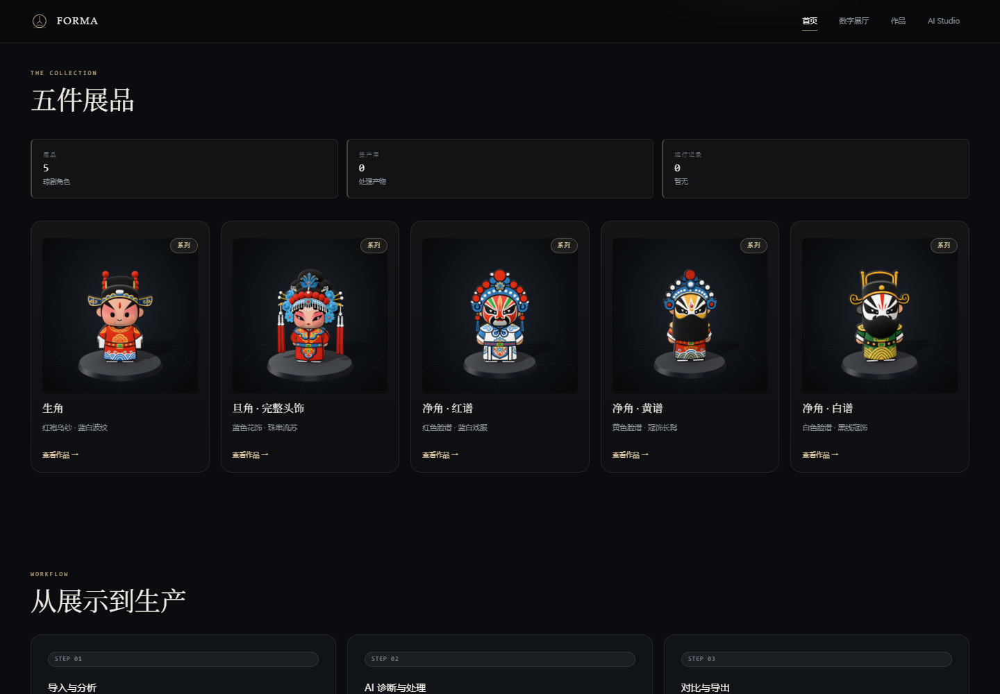
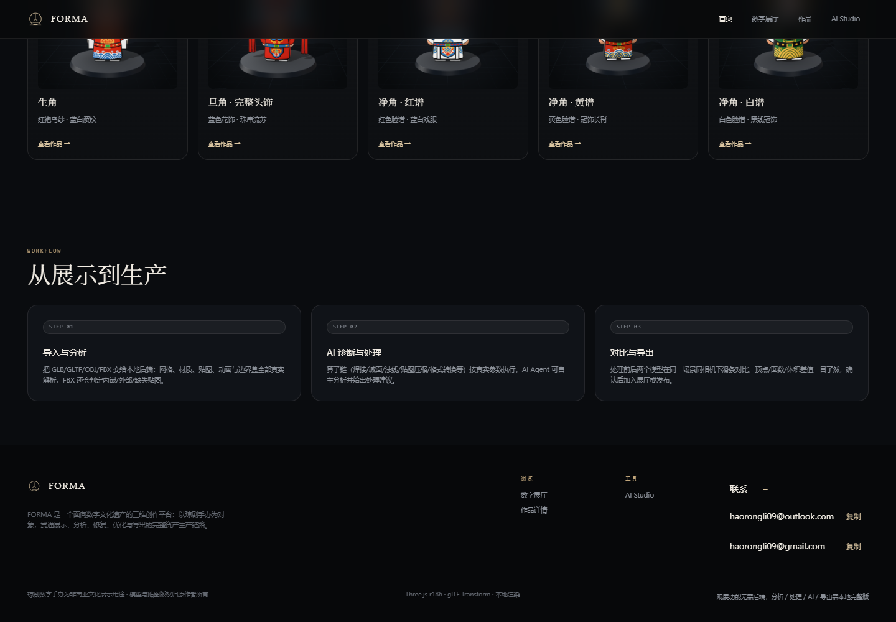
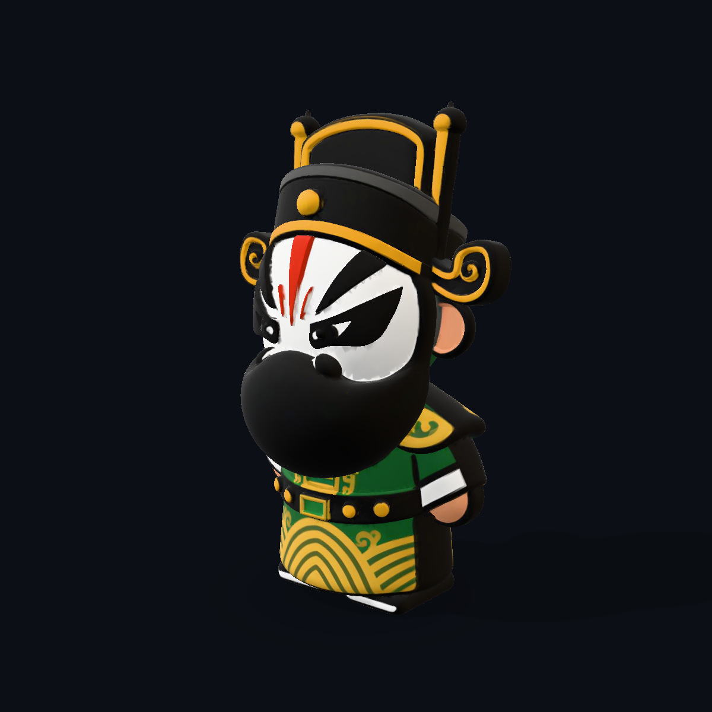

# RC1 作品集截图索引

58 张真实 Windows Edge 截图，均为原图复制，无局部修图。来源与 SHA256 见 [index.json](index.json)，完整条件和结果见 [本轮报告](../../RC1-PORTFOLIO-ACCEPTANCE.md)。

页面 before 来自本轮重新运行的 RC1 83453aa；after 来自 17ac8ff。页面图用于布局与真实加载验收；**模型效果只以固定机位、灯光、曝光的单独对照图判断**。

## 首页、联系与工作区

| 内容 | RC1 原版 | 本轮 |
|---|---|---|
| 首页完整页面 | [before](before-home-desktop.png) | [after](after-home-desktop.png) |
| 五件作品卡片 | [before](before-collection-desktop.png) | [after](after-collection-desktop.png) |
| 首页联系桌面展开 | [before](before-home-contact-desktop.png) | [after](after-home-contact-desktop.png) |
| 首页联系 390px 展开 | [before](before-home-contact-390.png) | [after](after-home-contact-390.png) |
| 详情联系桌面展开 | [before](before-work-contact-desktop.png) | [after](after-work-contact-desktop.png) |
| 详情联系 390px 展开 | [before](before-work-contact-390.png) | [after](after-work-contact-390.png) |

默认入口收起，展开截图用于确认可读性和操作目标，不代表邮箱始终常显。

## 五件实际路由

| 手办 | 详情 RC1 | 详情本轮 | Gallery RC1 | Gallery 本轮 |
|---|---|---|---|---|
| 生角 | [详情](before-work-sheng.png) | [详情](after-work-sheng.png) | [Gallery](before-gallery-sheng.png) | [Gallery](after-gallery-sheng.png) |
| 旦角 | [详情](before-work-dan.png) | [详情](after-work-dan.png) | [Gallery](before-gallery-dan.png) | [Gallery](after-gallery-dan.png) |
| 净角·红谱 | [详情](before-work-jing-red.png) | [详情](after-work-jing-red.png) | [Gallery](before-gallery-jing-red.png) | [Gallery](after-gallery-jing-red.png) |
| 净角·黄谱 | [详情](before-work-jing-yellow.png) | [详情](after-work-jing-yellow.png) | [Gallery](before-gallery-jing-yellow.png) | [Gallery](after-gallery-jing-yellow.png) |
| 净角·白谱 | [详情](before-work-jing-white.png) | [详情](after-work-jing-white.png) | [Gallery](before-gallery-jing-white.png) | [Gallery](after-gallery-jing-white.png) |

这里的 work 图均为真实 `#/work/:id` 路由，区别于旧 quality 脚本命名为 detail 的 Gallery 放大截图。

## 固定条件的模型前后对照

模型前后：1200×1200，studio 灯光，Neutral 色调，曝光 1，相同相机/target/FOV。前是 assets/models，后是 assets/portfolio-v1；未减面、未改几何/UV/贴图/材质。

| 展品正面 | 原 RC1 模型 | 法线修正版 |
|---|---|---|
| 生角 | [before](sheng-front-before.png) | [after](sheng-front-after.png) |
| 旦角 | [before](dan-front-before.png) | [after](dan-front-after.png) |
| 净角·红谱 | [before](jing-red-front-before.png) | [after](jing-red-front-after.png) |
| 净角·黄谱 | [before](jing-yellow-front-before.png) | [after](jing-yellow-front-after.png) |
| 净角·白谱 | [before](jing-white-front-before.png) | [after](jing-white-front-after.png) |

白谱残留问题没有隐藏；以下斜侧面对照仍可见面片：

| 模式 | before | after |
|---|---|---|
| 受光 | [before](jing-white-three-quarter-before.png) | [after](jing-white-three-quarter-after.png) |
| 法线可视化 | [before](jing-white-three-quarter-before-normals.png) | [after](jing-white-three-quarter-after-normals.png) |
| 无光照纹理 | [before](jing-white-three-quarter-before-unlit.png) | [after](jing-white-three-quarter-after-unlit.png) |

## 窄屏模拟与 Studio

**真机未验证。** 下列为桌面 Edge 视口模拟，不是 iOS/Android 手机实拍或触摸实测。

| 页面 | 390×844 | 768×844 |
|---|---|---|
| 首页，真实 Hero ready | [390px](after-home-390.png) | [768px](after-home-768.png) |
| 旦角详情，真实统计就绪 | [390px](after-work-390.png) | [768px](after-work-768.png) |
| Gallery，旦角加载完成 | [390px](after-gallery-390.png) | [768px](after-gallery-768.png) |
| Studio | [390px](after-studio-390.png) | [768px](after-studio-768.png) |

[RC1 旦角详情 390px](before-work-390.png) · [Studio 实际导入资产/版本/报告](after-studio-asset.png)。

Logo 均为原有标识和文字回退；本轮没有接入新的设计文件或动画。
