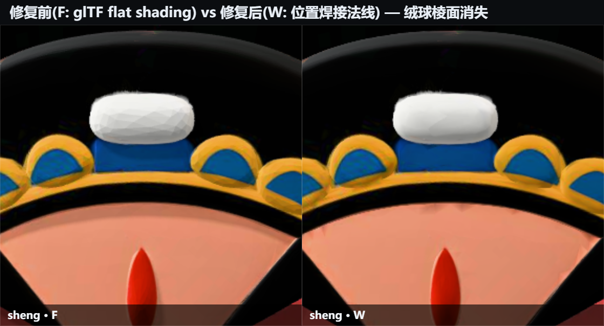
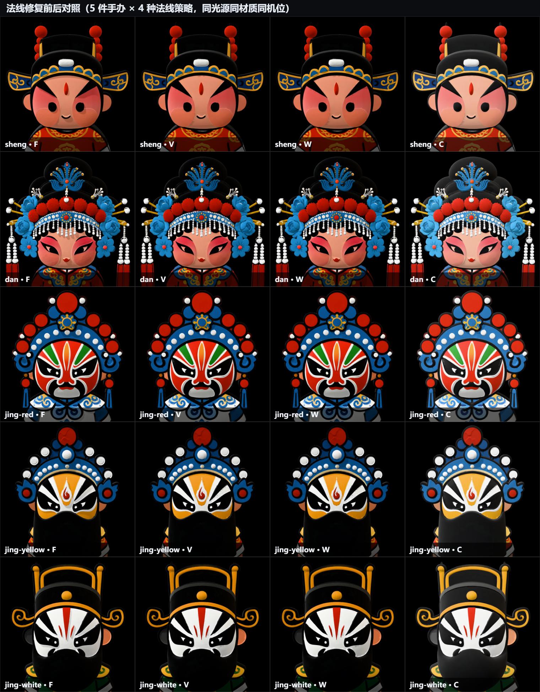
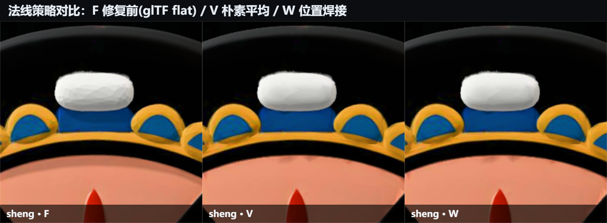
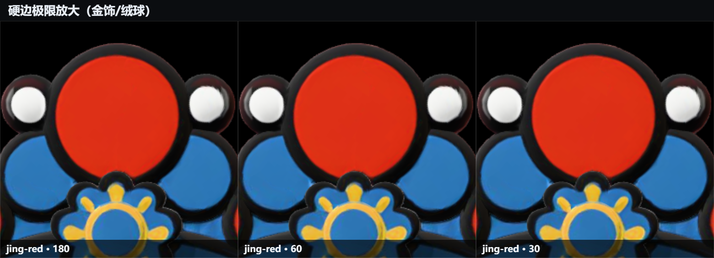
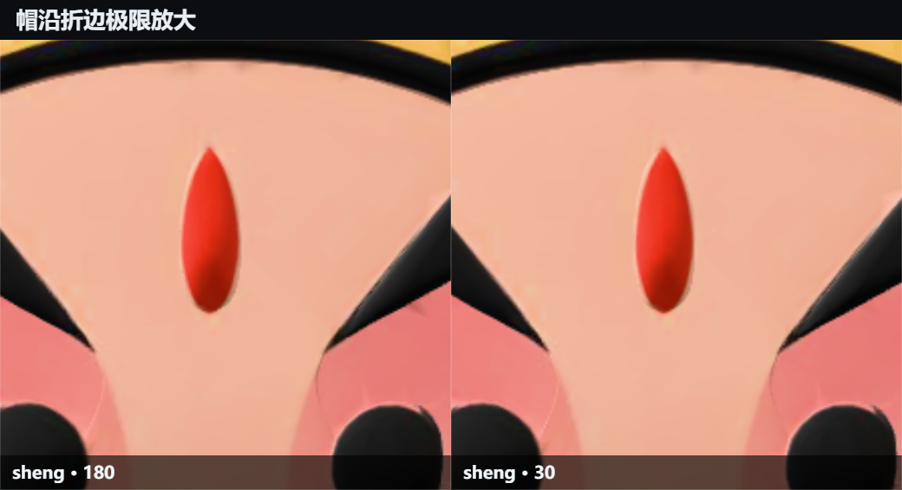

# 法线修复研究：前后实际画面对比与硬边阈值选型

所有图片都是**真实浏览器 WebGL 渲染结果**，不是示意图。同模型、同光源、同材质、同机位，唯一变量是法线策略。复现命令见文末。

## 一、修复前的真实画面是什么

源 GLB（从 V2 提取）的 primitive **没有 NORMAL 属性**。glTF 2.0 规范 §3.7.2 规定：缺 NORMAL 时必须按逐面着色处理；three.js 的 GLTFLoader 也正是这么做的——它把材质标记为 `flatShading = true`，用屏幕空间导数在片元里算面法线。

所以「修复前」不是渲染报错，而是**每一颗曲面零件都棱面化**。最明显的是头盔上的白色绒球：



左边是修复前（glTF 默认 flat shading），绒球表面能看到一圈圈多边形棱面；右边是修复后（位置焊接法线），曲面连续平滑。这个差异在正常观看距离下也可见，只是不如放大后明显——因此此前一直没被察觉。

五件手办同一对照的全景：



## 二、为什么需要「位置焊接」而不是直接平均

网格导出时 UV 接缝处的顶点是拆开的：同一个空间位置被若干个顶点索引共享（实测 12–19% 的顶点是这类重复顶点）。如果直接按索引平均法线（three.js 默认的 `computeVertexNormals()`），每个 UV 岛会各自独立平均，在岛边界留下暗色阴影接缝。

本项目对源资产和运行时导入都采用**按量化位置虚拟焊接后再面积加权平均**——顶点缓冲不做任何合并，只把法线归到同一焊接组里算。



## 三、硬边阈值：实证结论是「不需要」

任务书要求「保留合理硬边」。我们用 `--hard-angle` 做了 180°/90°/75°/60°/45°/30° 六档扫描。**结论：在这五件网格上没有任何可感知差异**，极限放大也看不出：




原因：这批网格的硬边本来就是**几何级**的——建模时在折边处已经拆分了顶点（每个 UV 岛边界都是硬边），不存在「被平滑抹掉的折痕」。因此交付版本采用 **180°（纯面积加权平滑）**，这是数学上最保守、最不会引入棱面伪影的选择；硬边由几何本身保证，无需着色阈值介入。

各档被排除出平滑的三角形数量（`excluded`）供参考：

| 角度 | sheng | dan | jing-red | jing-yellow | jing-white |
|---|---|---|---|---|---|
| 90° | 289 | 1652 | 629 | 319 | 365 |
| 60° | 1488 | 5024 | 3378 | 2306 | 2496 |
| 30° | 4641 | 12338 | 8549 | 6306 | 5872 |

## 四、修复过程中发现并修掉的一个连带缺陷

给 GLB 预烘焙 NORMAL 之外，加载管线还有一道运行时兜底：任何网格进来时缺法线就现场调用 `computeWeldedNormals()` 补上（这让用户导入的无法线 OBJ 也能正确着色）。

但**这道兜底原本是半残的**：GLTFLoader 在解析阶段看到缺 NORMAL 就已把材质设为 `flatShading = true`，我们补完法线却没人清这个标记——结果网格有了法线、着色却仍是逐面的，修复等于白做。`src/loaders/normals.js` 新增 `clearFlatShading()`，`src/loaders/importers.js` 在两处补法线后调用它。修复后同一模型的 `flatShading` 标志确认为 `false`，画面与预烘焙版本一致（像素差 <0.1%）。

## 五、量化数据摘录

同机位 192×192 下采样后逐像素统计（完整数据见 `normals-ab-report.json` / `hardedge-ab-report.json`）：

| 模型 | 主体亮度 F→W | 主体亮度 W→C(金属度修正) | 全画面差异 F→C |
|---|---|---|---|
| sheng | 78.9 → 79.0 | 79.0 → 88.9 | 15.3% 像素改变 |
| dan | 73.9 → 73.7 | 73.7 → 85.2 | 16.1% |
| jing-red | 88.9 → 89.4 | 89.4 → 98.1 | 15.1% |
| jing-yellow | 80.5 → 81.2 | 81.2 → 77.5 | 12.9% |
| jing-white | 87.2 → 87.4 | 87.4 → 81.8 | 13.9% |

两点读法：

1. **法线本身带来的亮度变化很小**（±1%），它改善的是**着色质量**（棱面→平滑），不是亮度。
2. **真正的亮度巨变来自 metallicFactor**：glTF 规范里缺省值是 1.0（纯金属），`base × (1-metal)` 把漫反射几乎清零，手办被渲染成暗哑金属。写明 `metallicFactor = 0` 后覆盖占比普遍提升 15–37%（jing-yellow 从 13.5% → 18.6%），形体完整度大幅改善。

## 复现

```bash
node serve.mjs 5173            # 需要先起本地服务器
node tools/fix-glb.mjs --hard-angle=90 --out=assets/variants/HA-90    # 生成变体
node tools/test-ab.mjs --study=normals                                # 法线对照
node tools/test-ab.mjs --study=hardedge                               # 硬边扫描
node tools/make-montage.mjs --dir=test-out/ab-normals --ids=sheng \
     --keys=F,V,W --cols=3 --cell=440 --crop=0.42,0.26,0.16,0.16 \
     --out=test-out/zoom.png                                          # 任意拼图
```
